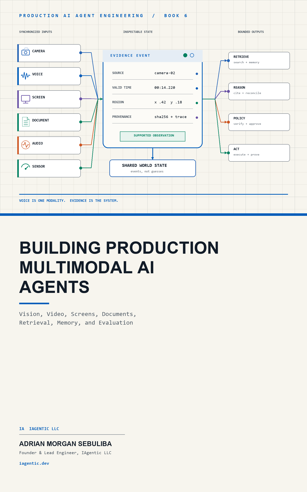

# Multimodal Agents



Companion code for *Building Production Multimodal AI Agents* (Book 6 of the
Production AI Agent Engineering series).

The repository follows the book from synchronized camera-and-voice capture to
visual grounding, video, screen agents, document understanding, Qdrant-backed
multimodal retrieval, cited RAG, event memory, sensors, policy gates,
observability, PostgreSQL row-level tenant isolation, Auth0 organizations, and
the IAgentic Multimodal Studio.

The `runs/` tree retains the manifests, measurements, provider traces, and
release results cited in the manuscript. Secrets and private raw recordings do
not belong in version control.

Repository: <https://github.com/IAgentic-LLC/multimodal-agents>

## Get the book

📘 [Amazon (Kindle)](https://www.amazon.com/dp/B0HLCQVVLV) · [Amazon (Paperback)](https://www.amazon.com/dp/B0HLCSPFRK) · [Leanpub](https://leanpub.com/buildingproductionmultimodalaiagentsmultimodal-agents)

## Start from a clean checkout

Python 3.12 or later is required. Install `uv`, then run:

```powershell
git clone https://github.com/IAgentic-LLC/multimodal-agents
cd multimodal-agents
uv sync
uv run pytest -q
```

Build and test the React and TypeScript Studio:

```powershell
cd frontend
npm ci
npm run build
npm run test:e2e
```

The Playwright configuration starts and stops the local Python application
automatically, so the UI suite does not depend on a server left running by a
previous session.

The authoring workspace has an additional manuscript-render audit:

```powershell
cd frontend
npm run test:book
```

That command intentionally requires the sibling `multimodal-agents-book`
checkout and its rendered HTML. It validates every chapter's opening evidence
figure, alternative text, source resolution, and desktop/mobile overflow. It
is separate from the public companion-repository suite so a clean code-only
checkout remains self-contained.

The deterministic suite requires no provider key. Live experiments use the
reader's own service accounts and environment variables; no credentials are
embedded in the code or retained artifacts.

Verify one chapter while reading:

```powershell
uv run python scripts/verify_chapter.py 19
```

Validate the complete book-to-code build-along contract:

```powershell
uv run python scripts/verify_course.py
```

`course_manifest.json` is the canonical episode map for the book and a future
YouTube playlist. It names what each episode builds, the exact files to type,
the smallest runnable demonstration, the deterministic verifier, retained
evidence, environment requirements, and the on-screen result. The manuscript's
37 “Follow along” sections are checked against this manifest so instructions
cannot silently drift away from working code.

The command runs the chapter's deterministic tests and validates its retained
JSON, JSONL, media, and trace artifacts. See `REPRODUCING.md` in the e-book for
the complete chapter-to-gate and live-service matrix.

## Gate 1: consented browser evidence capture

Run from a clean checkout with Python 3.12 or later:

```powershell
$env:PYTHONPATH = "src"
python -m multimodal_agents.server
```

Open `http://127.0.0.1:8000`, grant camera and microphone access, then hold
the record button while saying a reference such as, "Remember where I put
this." The app saves one JPEG frame, one Opus/WebM voice interval, and one
JSONL manifest entry under `runs/local-captures/`.

Captured media is local evidence, is ignored by version control, and must not
be committed.

## Production-shaped services

The repository includes Docker definitions for PostgreSQL, the API, the
Studio, Qdrant, OpenSearch, document-processing dependencies, and the
multi-agent coordinator's five specialists. See `deploy/` and the
service-specific Compose files for the exact commands and required variables.
Production authentication fails closed; the local identity harness must be
explicitly enabled and must never be used as a deployment default.

OpenSearch and the three capstone specialists (`deploy/oci/docker-compose.multi-agent.yml`)
join the coordinator's existing internal-only network and publish no port;
reach OpenSearch for the one-time indexing step with a one-off container on
that same network rather than exposing it. The coordinator's own Dockerfile
bundles the manuscript's figures at build time (`evidence-figures/`, synced
from the sibling book repository, not committed) and writes its edit-decision
log under `/tmp`, since the container's root filesystem is read-only.

## Observe the multi-agent coordinator with Langfuse

Chapter 36 uses Langfuse v4's OpenTelemetry-native Python SDK. The public UI
never receives a Langfuse key. The coordinator records one root `agent`
observation and one child observation per A2A specialist. It records status,
latency, evidence identifiers, release, and environment, but deliberately does
not record the user's question, media, OAuth token, or client credentials.

1. Start Langfuse v4 locally using its official Docker Compose guide and open
   `http://localhost:3001`.
2. Create an organization, a project, and a project API key.
3. Copy `.env.example` to an ignored environment file and add the Langfuse
   public and secret keys. Do not commit that file.
4. Start the orchestration stack. On Windows or macOS, use the local overlay
   so the container reaches Langfuse through `host.docker.internal`:

```powershell
docker compose --env-file .env.local `
  -f deploy/oci/docker-compose.multi-agent.yml `
  -f deploy/oci/docker-compose.multi-agent.local.yml up -d --build
```

5. Open `http://127.0.0.1:8092`, run an orchestration, and inspect the trace in
   Langfuse. Verify the retained shape and privacy contract:

```powershell
uv run python scripts/verify_langfuse_trace.py `
  --env-file .env.local
```

For a Linux VM, set `LANGFUSE_BASE_URL` to the private HTTPS address of the
Langfuse deployment and use the main Compose file without the local overlay.
Docker Compose is an evaluation/single-VM topology; use the Langfuse-supported
high-availability deployment approach when the telemetry service itself must
meet production availability objectives.

## The capstone: analysis, visualization, and edit-proposal specialists

`docker-compose.multi-agent.yml` also starts three more A2A specialists —
`analysis`, `visualization`, and `edit-proposal` — plus an internal-only
OpenSearch node (`opensearch`, never published on a host port) holding a
real hybrid-search index of the book's own retained evidence, text and
figures embedded with `gemini-embedding-2`. All three specialists only ever
observe: `edit-proposal` returns a bounded proposal with an evidence
citation, never a mutation, and refuses outright when nothing in the index
supports it. The coordinator's hardcoded `authority: observe_only` and
`action_gate: blocked_without_explicit_authority` are unchanged.

Each needs `GEMINI_API_KEY` in the environment. After the stack is up and
`opensearch` is healthy, build the index once:

```powershell
$env:OPENSEARCH_URL = "http://127.0.0.1:9200"  # or the service's address
uv run python src/multimodal_agents/run_opensearch_index.py --reset
```

This is a one-time manual step, the same spirit as the Langfuse project/key
setup above. Re-run it (without `--reset`, or with it to rebuild from
scratch) only when the retained evidence corpus changes.
